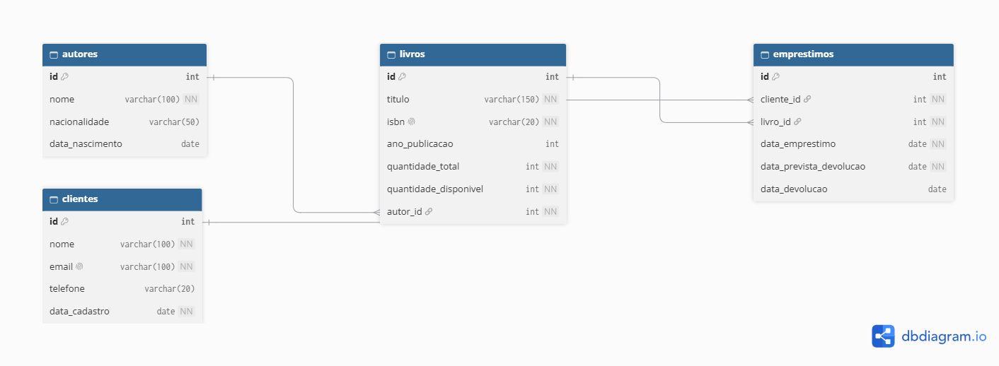

# BookStore Manager CLI

Sistema de gerenciamento de livraria via terminal, com menus interativos para autores, livros, clientes e empréstimos, gravando os dados em um banco PostgreSQL.

Projeto final do Módulo 01 do curso de Desenvolvedor Back-end Node.Js

## Funcionalidades

- Cadastro, consulta, atualização e remoção de **autores**, **livros** e **clientes**.
- **Empréstimos e Devoluções** com regras de negócio(disponibilidade, atraso e limite de emprestimos ativos)
- **Relatórios gerenciais** feitos com consultas SQL
- Empréstimos e devoluções em **transação**, para manter o estoque consistente


## Tecnologias

- Node.js 20+ e TypeScript
- PostgreSQL, acessado com driver `pg` e SQL via QueryTool no `pgAdmin`
- tsx(execução em desenvolvimento), ESLint e Prettier

## Pré-requisitos

- [Node.js](https://nodejs.org) 20 ou superior
- [PostgreSQL](https://www.postgresql.org) instalado e em execução
- [Git](https://git-scm.com)

## Como rodar

### 1. Clonar o repositório
```bash
git clone https://github.com/WolnyJunior/bookstore-manager-cli.git
cd bookstore-manager-cli
```
### 2. Instalar as dependências
```bash
npm install
``` 
### 3. Configurar as variáveis de ambiente
Copie o arquivo de acordo com seu Sistema Operacional; E preencha com os dados do seu banco
```bash
copy .env.example .env # Para Windows.
cp .env.example .env   # Para Linux/Mac:
```
|    Variável          |      Descrição                      |   Padrão       |
|    --------          | -----------------                   |   -------      |
| `DB_HOST`            | Host do PostgreSQL                  | `localhost`    |
| `DB_PORT`            | Porta do PostgreSQL                 | `5432`         |
| `DB_NAME`            | Nome do banco                       | obrigatória    |
| `DB_USER`            | Usuário do banco                    | obrigatória    |
| `DB_PASSWORD`        | Senha do banco                      | obrigatória    |

### 4. Criar o banco de dados
No pgAdmin ou no `psql`, execute:
```sql
CREATE DATABASE bookstore;
```

### 5. Criar as tabelas e os dados de teste
Execute o arquivo `database/script.sql` no banco `bookstore`, pelo Query Tool do pgAdmin ou pelo `psql`:

```bash
psql -U postgres -d bookstore -f database/script.sql
```
>**Atenção:** o script contém arquivos de criação de tabela, inserção de dados nas tabela e consultas.

### 6. Executar a aplicação
```bash
npm run dev
```
Para gerar a versão compilada e executá-la:
```bash
npm run build
npm start
```

## Banco de dados
O banco é relacional e modelado com 4 tabelas.



| Relacionamento | Descrição |
|---|---|
| `autores` 1:N `livros` | Um autor escreve vários livros |
| `clientes` 1:N `emprestimos` | Um cliente faz vários empréstimos |
| `livros` 1:N `emprestimos` | Um livro aparece em vários empréstimos |

O arquivo [`database/script.sql`](database/script.sql) reúne:
- **DDL:** criação das tabelas, com chaves primárias e estrangeiras, `UNIQUE`, `CHECK` e `DEFAULT`
- **DML:** dados de exemplo
- **Consultas relacionais:** JOINs, agrupamentos e filtros
- **Consultas dos relatórios gerenciais**

Um empréstimo é considerado **ativo** quando `data_devolucao` é nula.

## Arquitetura
O código é organizado em camadas, cada uma com uma responsabilidade:

```
Usuário > Menu > Controller > Service > Repository > Banco de dados
```

| Camada | Responsabilidade |
|---|---|
| **Menu** | Interação com o usuário no terminal |
| **Controller** | Converte o que foi digitado e chama o service |
| **Service** | Validações e regras de negócio |
| **Repository** | Acesso ao banco (SQL) |
| **Model** | Define o formato dos dados |

### Estrutura de pastas
```
bookstore-manager-cli
├── database
│   ├── DER.png
│   └── script.sql
├── src
│   ├── config
│   ├── controllers
│   ├── menus
│   ├── models
│   ├── repositories
│   ├── services
│   ├── utils
│   └── main.ts
├── .env
├── .env.example
├── .gitignore
├── .prettierignore
├── .prettierrc.json
├── eslint.config.mjs
├── package-lock.json
├── package.json
├── README.md
├── tsconfig.build.json
├── tsconfig.json
└── vitest.config.mts
```

### Scripts
- `npm run dev` | Roda em desenvolvimento(reinicia ao salvar)
- `npm run build` | Compila o TypeScript para `dist/`
- `npm start` | Roda o código compilado
- `npm run lint` | Verifica problemas no código (ESLint) |
- `npm run format` | Formata o código (Prettier) |
- `npm run typecheck` | Verifica os tipos do TypeScript sem gerar arquivos |

### Fluxo de trabalho (Git)

- `main`: versões estáveis, marcadas com tags (`v1.0.0`).
- `develop`: integração do trabalho em andamento.
- `feat/*`: uma tarefa por branch, nasce da `develop` e volta por Pull Request. Funcionalidades(banco de dados, autores, livros, clientes, empréstimos, relatórios e documentação)
- Commits no padrão Conventional Commits: `feat`, `fix`, `docs`, `style`, `test`, `chore`.

A organização das tarefas foi feita em um quadro Kanban: [Quadro no Trello](https://trello.com/invite/b/6aea9e68f7d33634282be284/ATTI841eb2373934943c5b0ce3b5ed200037522DD483/bookstore-manager-cli)


### Como usar

Ao iniciar, a aplicação conecta ao banco e abre o menu principal. Digite o número da opção e pressione **Enter**.

```
=== BOOKSTORE MANAGER ===
1 - Autores
2 - Livros
3 - Clientes
4 - Empréstimos
5 - Relatórios
0 - Encerrar aplicação
```

| Menu | Opções |
|---|---|
| **Autores** | Cadastrar, listar, buscar por ID, atualizar e remover |
| **Livros** | Cadastrar, listar (com o nome do autor), buscar por ID, atualizar e remover |
| **Clientes** | Cadastrar, listar, buscar por ID, atualizar e remover |
| **Empréstimos** | Registrar empréstimo, registrar devolução, listar todos e listar ativos |
| **Relatórios** | Resumo do acervo, livros mais emprestados, empréstimos atrasados, clientes mais ativos e livros por autor |

**Dicas:**
- Ao **atualizar** um registro, pressione Enter em um campo para manter o valor atual.
- Para cadastrar um livro ou registrar um empréstimo, você precisa dos IDs de autores, clientes e livros: veja-os na opção **Listar** de cada menu.
- Datas são digitadas no formato `AAAA-MM-DD` (exemplo: `1985-03-21`).
- Erros de validação aparecem como mensagens com o símbolo ⚠, e o menu continua funcionando.

### Regras de negócio

**Autores**
- O nome é obrigatório (até 100 caracteres).
- A data de nascimento, se informada, deve ser uma data real e não pode estar no futuro.
- Um autor que possui livros não pode ser removido.

**Livros**
- Título e ISBN são obrigatórios, e o ISBN deve ser único.
- O ano de publicação, se informado, deve estar entre 1 e o ano atual.
- A quantidade de exemplares deve ser um inteiro maior que zero.
- O autor informado deve existir.
- Ao cadastrar, os exemplares disponíveis começam iguais ao total. Ao alterar o total, o disponível é recalculado descontando os exemplares emprestados.
- Um livro que possui empréstimos registrados não pode ser removido.

**Clientes**
- Nome e e-mail são obrigatórios. O e-mail precisa ter formato válido, é salvo em minúsculas e deve ser único.
- A data de cadastro é preenchida automaticamente.
- Um cliente que possui empréstimos registrados não pode ser removido.

**Empréstimos**
- O cliente e o livro precisam existir.
- O livro precisa ter pelo menos um exemplar disponível.
- Cliente com empréstimo em atraso não pode pegar novos livros.
- Cada cliente pode ter no máximo 3 empréstimos ativos ao mesmo tempo.
- O prazo de devolução é de 14 dias.
- Cada empréstimo só pode ser devolvido uma vez. Na devolução, o exemplar volta ao estoque e, se houve atraso, os dias são informados.
- Empréstimo e devolução usam **transação**: o registro e o ajuste do estoque acontecem juntos ou não acontecem.

## Autor

Desenvolvido por Wolny Junior, como projeto avaliativo do curso Desenvolvedor Back-end Node.JS